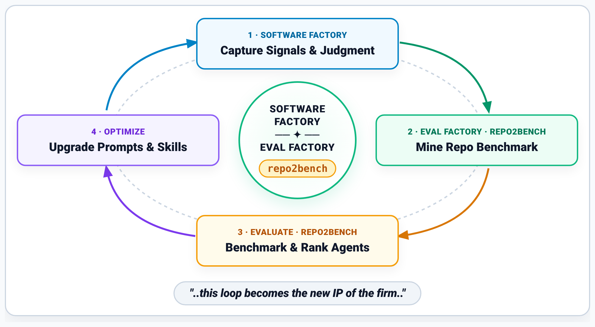
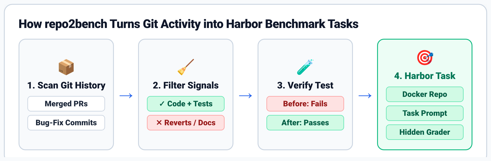

# `repo2bench`: Build your own custom code benchmark
### Build the Eval Factory for Your Software Factory: Benchmark Coding Agents on Your Own Repo with [`repo2bench`](https://github.com/amirmordechai/repo2bench) (Built on [`Harbor`](https://github.com/harbor-framework/harbor))

<p align="center">
  
</p>

**`repo2bench`** mines any Git repository's pull-request history into a verified, leak-free coding agent benchmark and evaluates **`Harness × Model × Thinking Budget`** configurations in isolated **[Harbor](https://github.com/harbor-framework/harbor)** Docker sandboxes—producing your repo's Quality-vs.-Cost leaderboard and chart in two CLI commands.

---

## Why `repo2bench`?

How do most teams pick their coding agent today? Brand hype, top-down mandates, 30 minutes of manual "vibe testing," or checking generic public leaderboards like **[Terminal-Bench 4.0](https://www.vals.ai/benchmarks/terminal-bench-4)**, **[Vibe Code Bench](https://www.vals.ai/benchmarks/vibe-code)**, or **[Artificial Analysis](https://artificialanalysis.ai/leaderboards/models)**—where frontier models like **Gemini 4 Carbon** and **Gemini 4 Argon** compete on public benchmarks. None of those test *your* architecture, *your* conventions, or *your* test suite.

Easy code generation makes verification the bottleneck: when everyone has access to the same frontier models and agent harnesses, your unique advantage is your engineering judgment—and how systematically you turn that judgment into an **Eval Factory** for your **Software Factory**.

When you evaluate `Harness × Model × Thinking Budget` directly on your own repo:
- **Counter-intuitive quality & cost winners emerge:** Models with higher per-token list prices can cost **40%+ less per task** when they localize bugs in half the turns, while cranking `Thinking Budget` from `medium` to `high` can actually *lower* accuracy on multi-module repos.
- **Hidden harness bottlenecks surface:** Container trajectories immediately reveal where an agent's tool loop, prefix caching, or `pytest` strategy breaks down on your repo's layout—giving you a concrete `Train / Held-Out Test` split to evolve repo-specific prompts, skills, and verification scripts (manual or automated via [`Harness²`](https://github.com/google-research/harness2)).

---

## Quickstart

### 1. Install `repo2bench`

```bash
pip install -e .
```

### 2. Mine Verified Harbor Tasks from Any Git Repo

```bash
repo2bench mine \
  --repo /path/to/your-repo \
  --limit-num-tasks 20 \
  --output ./my-repo-bench
```

<p align="center">
  
</p>

What `repo2bench` does automatically:
1. **Filters Git Signals:** Scans merged PRs/commits, keeps changes that touch both source code and unit tests, and drops noisy commits (`git revert`, force-pushes, docs/typos, or massive refactors).
2. **Verifies `Fail → Pass` Test Signal:** Validates every task in a clean container—the PR's unit test **must fail** before the fix (`score = 0.0`) and **must pass** after the developer's fix (`score = 1.0`).
3. **Eliminates Solution Leakage:** Splits each PR into:
   - **Starting Workspace (`environment/`):** Repository checked out at `base_commit` before the fix, with future Git history stripped.
   - **Goal-Oriented Prompt (`instruction.md`):** Synthesizes a pre-commit problem statement from the issue/PR motivation and test expectations—stripping target file paths and commit-message solution spoilers.
   - **Hidden Test Grader (`tests/`):** Runs only after the agent finishes.

### 3. Evaluate & Rank Coding Agents (`repo2bench eval`)

```bash
repo2bench eval \
  --dataset ./my-repo-bench \
  --agents antigravity,pi \
  --models gemini-4-argon,gemini-3.8-flash \
  --thinking medium,high \
  --output ./results/my-repo-eval
```

`repo2bench eval` executes each `(agent × model × thinking)` configuration in isolated Harbor Docker containers, computes `Pass@1`, mean API cost per task, turn count, and wall-clock speed, and writes `leaderboard.md`, `leaderboard.json`, and the `leaderboard_xy` Quality-vs.-Cost chart.

---

## Repository Structure

```text
repo2bench/
├── src/repo2bench/                 # Core CLI & Harbor task mining pipeline
├── tests/                          # Unit tests for repo2bench
├── docs/assets/                    # Architecture & pipeline diagrams
└── examples/
    └── pydantic_marimo_blog/       # Full empirical case study ("Build your own custom code benchmark")
        ├── README.md               # Case study walkthrough & reproduction guide
        ├── datasets/               # Mined Harbor datasets (10 Train + 20 Held-Out Test PRs)
        ├── reports/                # Empirical Pass@1, Reward, Cost & Speed summaries (180 trials)
        ├── optimized_agy_ws/       # Optimized Antigravity workspace (GEMINI.md + pytest-loop skill)
        └── scripts/                # Mining & evaluation scripts used in the blog post
```

---

## End-to-End Case Study (`examples/pydantic_marimo_blog/`)

See **[`examples/pydantic_marimo_blog/README.md`](examples/pydantic_marimo_blog/README.md)** for the full datasets, empirical evaluation reports across 8 Gemini agent configurations, and the [`Harness²`](https://github.com/google-research/harness2) optimization case study from the accompanying blog post (*"Build your own custom code benchmark — Build the Eval Factory for Your Software Factory"*).

---

## License

Apache 2.0

---

## Disclaimer

Disclaimer: This code is provided "as-is" as a demonstration only to illustrate a potential solution. The code does not constitute a Google product or service of any kind, and Google offers no support, warranties, or liability of any kind with its regard. Whoever chooses to use this code accepts all responsibility related to it, including for its implementation, use, and ongoing maintenance. For the avoidance of doubt, this code is not eligible for the Google Open Source Software Vulnerability Rewards Program.
